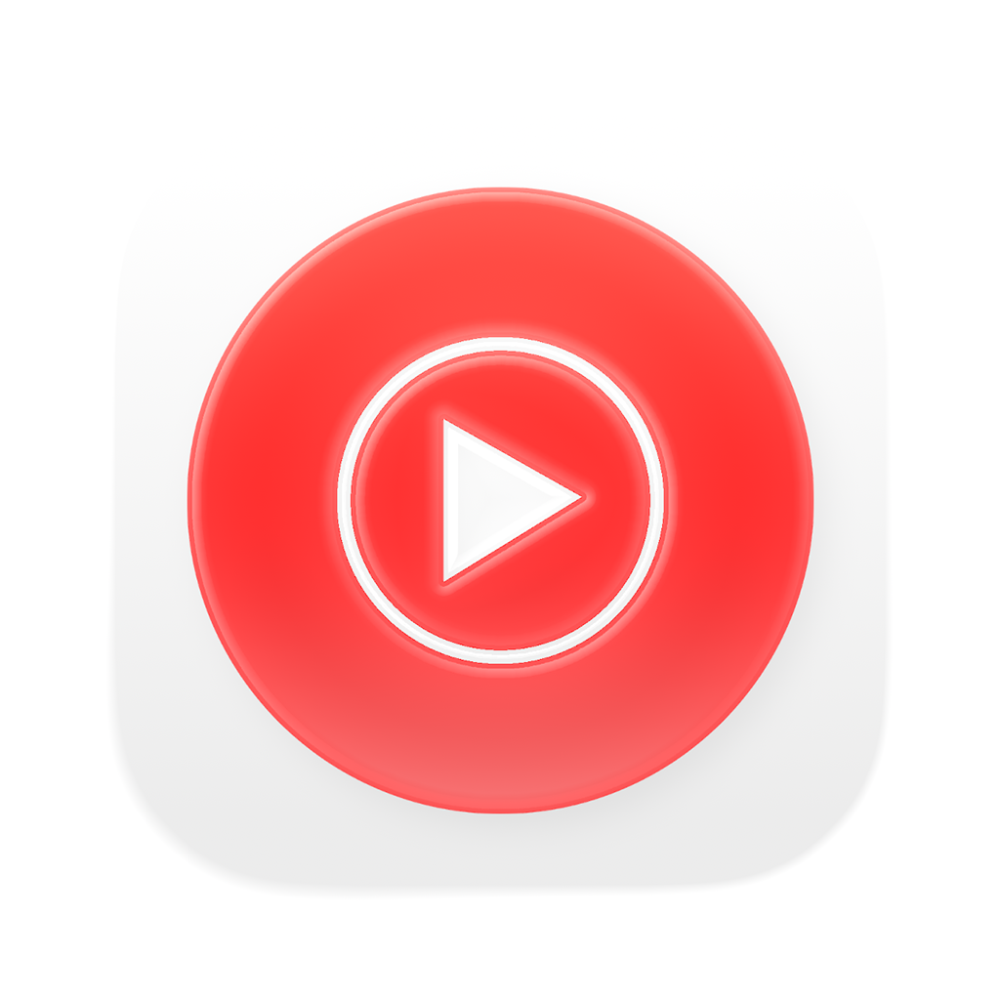
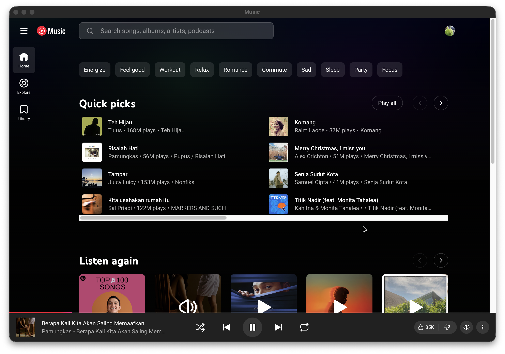
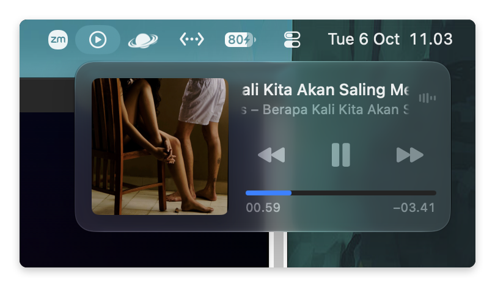

  

# Music: Lightweight YouTube Music Desktop App for macOS with Synced Lyrics and Safari Web Extensions Support

Music is an unofficial, open-source app that brings YouTube Music to your Mac. Built with Swift and WebKit for Apple Silicon and Intel Macs, it lets you enjoy your favorite tracks while you work or browse, without worrying about accidentally closing a browser tab. Your music keeps playing in the background, even when you close the app window.

Designed with privacy and security in mind, Music has no developer-operated backend and sends no personal data, analytics, or listening history to the developer. Official installers are signed with an Apple Developer ID and notarized by Apple. See [Privacy](#privacy) for details.

  

## Download

Music 1.2.0 requires macOS 15.4 or later.

 
For Macs with Apple Silicon chips: M1, M2, M3, and later.

 
For Macs with an Intel processor.

[See GitHub Releases](https://github.com/indradprasetya/yt-music-webkit/releases)

Enjoying Music? Give it a **Star** on GitHub to help others discover it.

<!-- GitHub's www redirect forces a full navigation so the README scroll position is not retained. -->

## Features

- **Native Controls menu:** Control playback, volume, and mute, or choose Shuffle and Repeat Off, All, or One. Shuffle and Repeat stay in sync with YouTube Music.
- **Background playback:** Music keeps playing when you close the window. Click the Dock icon to reopen it, or press Command-Q to quit.
- **Custom app icons:** Personalize Music with your own Light and Dark icons. Your choices stay saved across updates.
- **Extensions:** Use your favorite compatible Safari Web Extensions from the App Store in Music.
- **Custom scripts:** Import local JavaScript in Settings → Scripts. New scripts start disabled. Enable a script and click Apply Scripts to reload YouTube Music while Settings stays open.
- **Synced Lyrics (Beta):** Lyrics follow your music, with the current line highlighted and kept centered. Click a timed line to jump to that part of the song. The feature is on by default and can be turned off in **Settings → Lyrics**. When synced lyrics aren’t available, plain lyrics are shown when possible. See [lyric sources, timing adjustments, and attribution](#lyrics-sources-and-attribution).
- **macOS Now Playing:** Play, pause, and change tracks from the system's playback controls.

  

Native app communication used by some Safari extensions is unavailable in Music. Refresh List checks installed extensions; Apply Extensions reloads the page to apply your choices and keeps Settings open.

## Custom scripts

In Settings → Scripts, import a local `.js` file, enable its checkbox, and click Apply Scripts. Imports start disabled; enabled choices are saved across restarts. Removing a script deletes Music’s saved copy and leaves the original file unchanged. Applying changes reloads the page and may interrupt playback.

Scripts must be standalone UTF-8 `.js` files up to 1 MB. They run after the document loads by default, in a separate JavaScript world with access to the page DOM. Supported userscript metadata includes `@name`, `@grant none`, `@match https://music.youtube.com/*` (also `*://music.youtube.com/*`), and `@run-at document-start` or `document-end`. Metadata such as description, author, version, and license is accepted; `@noframes` is always enforced. Privileged `GM_*`/`GM.*` APIs, access to the page’s JavaScript variables, external `@require` dependencies, automatic updates, and other userscript directives are unsupported. Unsupported metadata and invalid JavaScript are reported when importing.

## Lyrics sources and attribution

Music’s native provider request flow is adapted from [syncedlyrics](https://github.com/moehmeni/syncedlyrics), copyright © 2022 Momo, under the MIT license. The upstream revision, modifications, and full MIT notice are included in [THIRD_PARTY_NOTICES.txt](THIRD_PARTY_NOTICES.txt), which is also bundled with the app. Music does not bundle Python or contact a server operated by syncedlyrics. The provider adapters run in Swift and contact [NetEase Cloud Music](https://music.163.com/) and [LRCLIB](https://lrclib.net/) directly. Changes to those services may still require updates to Music.

These services supply the responses; they are not credited as the owners of every song’s lyrics. Lyrics remain subject to their songwriters’, publishers’, and other rights holders’ rights. Music’s GPL license and syncedlyrics’ MIT license cover software, not the lyrics catalog, and do not replace applicable provider terms or permissions. Music is not affiliated with or endorsed by these providers or YouTube. This integration is not a claim of authorization to redistribute their catalogs.

Synced Lyrics is on by default. You can turn it off in Settings → Lyrics, and Music remembers your choice. When timing is available, lyrics follow playback: the current line stays centered and appears larger. Scrolling slows gently as it reaches the active line, and manual scrolling immediately interrupts the animation. Text stays sharp, with a fade at the top and bottom edges of the scrolling area. Space above the first line and below the last lets both remain centered. New tracks reset the scrolling position. Reduced Motion disables transitions and smooth scrolling. Click a timed lyric line to seek to it, or focus the line and press Return or Space; timing adjustments are included when seeking. Close timing settings by clicking outside or pressing Escape. Untimed lyrics remain clear, readable text because they have no reliable seek positions.

Timing offsets are saved automatically on this Mac for each YouTube video. When a video ID is unavailable, Music uses the title, artist, and duration to identify the track. Only nonzero adjustments are stored; setting the offset to zero or choosing Reset removes that entry. Offsets shift lyric timestamps; they do not change audio speed or correct a cover with a different tempo.

Music does not host a lyrics catalog, bundle song lyrics with the app, or save fetched lyrics to disk. It first tries NetEase, then LRCLIB if necessary, preferring synchronized lyrics over plain text. It accepts matching titles and artists with nearby durations; differing versions may only have unsynchronized text. If both providers fail or have no suitable match, the original YouTube Music panel remains available. Availability, timing, and coverage vary by song and region.

## Privacy

Music does not collect personal data or send analytics, telemetry, or listening history to the developer. The app has no developer-operated backend.

Music displays the YouTube Music website using WebKit. Google/YouTube may collect and process data when you sign in, listen, or interact with the service, as described in [Google's Privacy Policy](https://policies.google.com/privacy). WebKit stores cookies and website data locally on your Mac to maintain your session.

Extensions you enable may read or change YouTube Music pages and access other sites or browser data according to the permissions you approve. Music stores your enabled extensions and approvals locally. The extension developer, not Music, controls any data its extension collects or sends.

Custom scripts are stored locally and run only in the main frame at `https://music.youtube.com`. They can read and change the page, so import only scripts you trust. Script authors control any network requests their code makes.

When Synced Lyrics is enabled, Music sends the current track title and artist directly to NetEase Cloud Music (`music.163.com`) and, when needed, LRCLIB (`lrclib.net`). Duration is used locally to compare candidate tracks. Providers receive standard connection information, including your IP address, and process it under their own policies. Requests use a separate temporary network session without your YouTube/Google session cookies or account credentials. Provider responses and anonymous session cookies stay in memory; fetched lyrics are not saved to disk. Metadata is not sent to the Music developer or the syncedlyrics maintainers. Nonzero timing adjustments and their track identifiers are stored in local app preferences. Saved offset values and video IDs are not sent to lyric providers.

Update checks, installer downloads, What's New, and startup message checks contact GitHub or GitHub Pages. These requests share standard connection information, such as your IP address, with GitHub under its [Privacy Statement](https://docs.github.com/en/site-policy/privacy-policies/github-general-privacy-statement). Startup messages use a separate, temporary web session without your YouTube cookies. The last successfully checked app version and IDs of one-time messages already shown stay on your Mac; neither is sent with message checks.

Official release installers are signed with an Apple Developer ID and notarized by Apple. Sparkle verifies update signatures before installation.

## Show your support

Thank you so much for the boba tea! 🧋 Your support means a lot to me and helps me keep improving Music. I hope this little app makes your everyday listening a little better. Happy listening, and thanks for being part of the journey! 🎶

[🧋 Buy me a boba tea on Ko-fi](https://ko-fi.com/indradprasetya)

## License

Copyright © 2026 indradprasetya.

Music's source code is licensed under the **GNU General Public License version 3 only** (`GPL-3.0-only`). You may use, modify, and redistribute it under the terms of [LICENSE](LICENSE). It is provided without warranty.

When distributing Music or a modified version, provide the corresponding source code under GPLv3. See [Build and release](#build-and-release) for instructions.

Third-party components retain their own licenses. [THIRD_PARTY_NOTICES.txt](THIRD_PARTY_NOTICES.txt) contains the notices for Sparkle and its bundled components. Both license files are included in the app's `Contents/Resources` directory.

Music is a third-party app and is not affiliated with, endorsed by, or sponsored by Google LLC or YouTube. YouTube Music, its branding, and the content accessed through the service are not covered by this project's license and remain subject to their respective owners' rights and the [YouTube Terms of Service](https://www.youtube.com/static?template=terms).
