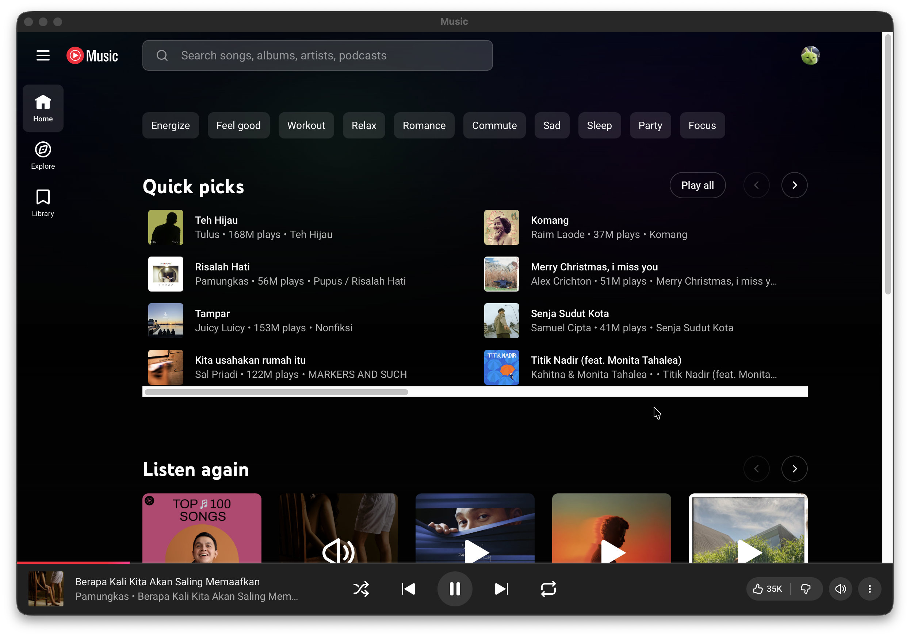
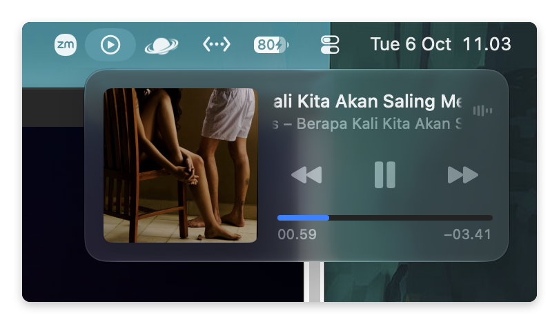

  

# Music: Lightweight YouTube Music Desktop App for macOS with Synced Lyrics and Safari Web Extensions Support

Music is an unofficial, open-source app that brings YouTube Music to your Mac. Built with Swift and WebKit for Apple Silicon and Intel Macs, it lets you enjoy your favorite tracks while you work or browse, without worrying about accidentally closing a browser tab. Your music keeps playing in the background, even when you close the app window.

Designed with privacy and security in mind, Music has no developer-operated backend and sends no personal data, analytics, or listening history to the developer. Official installers are signed with an Apple Developer ID and notarized by Apple. See [Privacy](#privacy) for details.

  

## Download

Music 1.2.0 requires macOS 15.4 or later.

 
For Macs with Apple Silicon chips: M1, M2, M3, and later.

 
For Macs with an Intel processor.

[See GitHub Releases](https://github.com/indradprasetya/yt-music-webkit/releases)

Enjoying Music? Give it a **Star** on GitHub to help others discover it.

<!-- GitHub's www redirect forces a full navigation so the README scroll position is not retained. -->

## Features

- **Native Controls menu:** Control playback, volume, and mute, or choose Shuffle and Repeat Off, All, or One. Shuffle and Repeat stay in sync with YouTube Music.
- **Background playback:** Music keeps playing when you close the window. Click the Dock icon to reopen it, or press Command-Q to quit.
- **Custom app icons:** Personalize Music with your own Light and Dark icons. Your choices stay saved across updates.
- **Extensions:** Use your favorite compatible Safari Web Extensions from the App Store in Music.
- **Custom scripts:** Import local JavaScript in Settings → Scripts. New scripts start disabled. Enable a script and click Apply Scripts to reload YouTube Music while Settings stays open.
- **Synced Lyrics (Beta):** Follow along with lyrics that scroll automatically as the song plays. Word-by-word highlighting is available for supported songs. Click a line to jump to that part of the song, or hover over a line and click its sync button when the vocals begin to align the lyrics. The gear lets you adjust timing or choose another matching provider, remembered for that song. Enabled by default; manage it in **Settings → Lyrics**.
- **macOS Now Playing:** Play, pause, and change tracks from the system's playback controls.

  

## Custom scripts

In Settings → Scripts, import a local `.js` file, enable its checkbox, and click Apply Scripts. Imports start disabled; enabled choices are saved across restarts. Removing a script deletes Music’s saved copy and leaves the original file unchanged. Applying changes reloads the page and may interrupt playback.

Scripts must be standalone UTF-8 `.js` files up to 1 MB. They run after the document loads by default, in a separate JavaScript world with access to the page DOM. Supported userscript metadata includes `@name`, `@grant none`, `@match https://music.youtube.com/*` (also `*://music.youtube.com/*`), and `@run-at document-start` or `document-end`. Metadata such as description, author, version, and license is accepted; `@noframes` is always enforced. Privileged `GM_*`/`GM.*` APIs, access to the page’s JavaScript variables, external `@require` dependencies, automatic updates, and other userscript directives are unsupported. Unsupported metadata and invalid JavaScript are reported when importing.

## Lyrics sources and attribution

### How the five sources are compared

- Music checks NetEase, LRCLIB, AMLL, Better Lyrics, and lrcmux on each fresh lookup, even after finding word timing. Providers in a requested cooldown are temporarily skipped.
- Cached results are reused. **Try Again** starts a fresh lookup.
- **Automatic** prefers valid word/syllable timing over line timing. When timing is equal, the order is **Better Lyrics → NetEase → LRCLIB → AMLL → lrcmux**.
- The Lyrics gear lists matching timed providers. You can switch between them immediately without another request.
- Manual choices are saved on this Mac for each song and playback mode. Choose **Automatic** to clear a saved choice.
- If your saved provider is unavailable, Music temporarily uses the best available result and explains the fallback in the gear panel.
- If no readable timed lyrics are found, the original YouTube Music panel stays visible. This includes untimed results and NetEase records containing only credits.

Hover over a timed line, or focus it with the keyboard, to reveal its sync button on the right. Click when that line starts being sung to align all lyric timing with the current playback position. This saves a single offset for that song, playback mode and lyric source. Timing from other providers is kept separately. Reset clears the current timing adjustment without changing the provider choice. A single offset cannot repair incorrect timing between individual lines.

| Source | API used by Music | Data used for matching and display |
| --- | --- | --- |
| [NetEase Cloud Music](https://music.163.com/) | `music.163.com/api/cloudsearch/pc` and `/api/song/lyric/v1` | Matching titles, artists and nearby catalog durations; LRC line timing or YRC word timing. These are undocumented service endpoints and can reject anonymous requests. |
| [LRCLIB](https://lrclib.net/docs) | `lrclib.net/api/search` | Matching title, artist and catalog duration; LRC and Lyricsfile word timing when supplied. Public lookup does not require a key. |
| [AMLL TTML DB](https://github.com/amll-dev/amll-ttml-db) | `api.amll.dev/v1/lyrics/search` and `/v1/lyrics/get` | Community TTML. Timing requires a NetEase catalog ID associated with audio within two seconds of the current duration, even if NetEase's lyric endpoint fails. Title/artist-only matches do not replace native lyrics. |
| [Better Lyrics](https://docs.betterlyrics.org/) | `api.betterlyrics.org/getLyrics` | Title, artist, album when available, and rounded audio duration are sent to its matching/cache endpoint. The returned TTML is parsed locally. The response does not always include independent track metadata; matching relies on the service's response to that request. |
| [lrcmux](https://lrcmux.dev/docs) | `api.lrcmux.dev/get` | Requests word timing with JSON output, allowing line timing when word timing is unavailable. Returned title, artist and duration must match; word text, ordering and millisecond ranges are validated locally. |

NetEase, LRCLIB and lrcmux synchronization uses a two-second catalog-duration tolerance. Word arrays that do not reproduce the line text or contain invalid times are not used as word timing. A TTML document's final timestamp or `body dur` is not proof of the recording's audio duration. Album changes invalidate lyric lookups so a stale Better Lyrics cache match is not reused. Covers, music videos with long intros, live recordings, edits and remasters may still have different arrangements or offsets. Matching and timing are not guaranteed for every song or region.

### Public access, rate limits and failures

Music uses anonymous, read-only access with an identifying `User-Agent`; it includes no provider API keys or account credentials. It does not use private extension keys, authenticated refresh/admin endpoints, or bulk catalog downloads.

- **Better Lyrics:** its [public TTML access](https://docs.betterlyrics.org/docs/authentication) serves cached queries without a key. An uncached request can return `401`; Music treats that as an unavailable public match for that song, not a request to sign in or disable other cached songs. The operator does not issue the extension's key to other projects. Album and duration affect the cache key, so missing or different metadata can miss an existing entry. [Rate limits](https://docs.betterlyrics.org/docs/rate-limiting) vary by IP/tier and can change.
- **lrcmux:** its [public API documentation](https://lrcmux.dev/docs) currently lists 60 requests per minute, burst 10, with cache hits excluded. Music spaces lrcmux requests at least one second apart and honors `Retry-After`. Limits can change, and other clients sharing an IP may consume the same quota.
- **AMLL:** its [API overview](https://amll.dev/en/reference/http-api/overview.html) currently documents an average limit of 50 requests/second/IP. Music only uses its public lyric search/get endpoints.
- Each source has its own request deadline and cooldown: up to ten seconds for NetEase/LRCLIB and six seconds for each other source. Lookups currently visit sources in sequence, so timeouts can add up; native YouTube lyrics remain available while loading. `429`/`503` responses honor `Retry-After`, with bounded retries for temporary `503` responses. A failure from one source does not discard valid lyrics from another. `502` indicates a gateway/upstream failure and is not proof that a song has no lyrics.

These services are independent of Music. Availability, catalogs, access rules and response formats can change or stop working. The public endpoints are not a service-availability guarantee. Turn the feature off in Settings → Lyrics to stop these lookups.

### Software licenses, content rights and attribution

Music's NetEase/LRCLIB request flow is adapted from [syncedlyrics](https://github.com/moehmeni/syncedlyrics), copyright © 2022 Momo, under MIT. The exact upstream revision, modifications and full MIT notice are in the bundled [THIRD_PARTY_NOTICES.txt](THIRD_PARTY_NOTICES.txt). The AMLL, Better Lyrics and lrcmux adapters and the native TTML parser are independently written. Music does not bundle Python, contact a syncedlyrics-operated server, or include the providers' server code or client libraries.

| Upstream project/service | Software/data license distinction |
| --- | --- |
| NetEase Cloud Music | Access and content remain subject to the provider's applicable terms and rights holders' permissions; Music does not relicense its service or catalog. |
| LRCLIB | The published [server software is MIT](https://github.com/tranxuanthang/lrclib/blob/main/LICENSE). That software license is not a blanket license to every lyric in its database. |
| AMLL | The [API server is MIT or Apache-2.0](https://github.com/amll-dev/amll-ttml-api#许可). [AMLL TTML DB](https://github.com/amll-dev/amll-ttml-db#共享协议) applies CC0-1.0 to contributor-authored material and the original provider's terms to external data. Underlying song/lyric rights remain separate. Its AGPL libraries and server are not bundled. |
| Better Lyrics | Its [server code is GPLv3](https://github.com/better-lyrics/api/blob/master/LICENSE). Music calls the public HTTP API and does not redistribute that server. [Its catalog can involve lrc.red and other upstream providers](https://github.com/better-lyrics/api#data-sources); GPLv3 is not a license to their lyric content. |
| lrcmux | Its [server code is MIT](https://github.com/f1nniboy/lrcmux/blob/main/LICENSE). Music calls its public API without bundling the server. Its aggregated lyric responses remain subject to the originating sources' terms and rights. |

The footer identifies the service that returned the selected result, such as `Lyrics from Better Lyrics` or `Lyrics from lrcmux (KuGou)`. Music names an underlying provider only when explicit response metadata identifies it. AMLL platform IDs identify associated recordings, not the original lyric supplier; the TTML format alone does not establish Apple Music provenance. Source names do not imply ownership, partnership or endorsement. Links here and in the bundled notices acknowledge the services and their contributors; no provider name is required in Music's README title.

Music's GPLv3 license and the other software licenses cover code, not a blanket right to song lyrics, translations, artwork or catalogs. Those rights remain with songwriters, publishers and other rights holders. Public API access, successful requests and attribution do not replace any required content permissions or applicable service terms. Music does not host, bundle, export or mirror a lyric catalog, and fetched lyrics are not written to disk. This integration and these notices are not a claim that every upstream record is authorized for every use. Distributors and operators remain responsible for permissions required for their use; adding a credit alone does not resolve missing rights.

The full notices for code actually included in Music remain in `THIRD_PARTY_NOTICES.txt`, shipped alongside `LICENSE` in `Contents/Resources`. The service references in that file acknowledge remote APIs; they do not mean those servers are bundled. Do not remove required bundled software copyright/license notices when redistributing Music.

### Timing controls

- **Enable or disable:** Use **Settings → Lyrics**. Synced Lyrics starts enabled, and Music remembers your choice.
- **Follow the lyrics:** The active line is larger and stays centered. Manual scrolling pauses automatic scrolling. Reduced Motion disables transitions and smooth scrolling.
- **Jump to a line:** Click a timed lyric, or focus it and press Return/Space. Seeking includes your saved timing adjustment.
- **Adjust timing:** Open the gear. The **− / +** buttons shift lyrics by **0.01 seconds**. Click the number to enter seconds manually; press Enter or leave the field to save. Escape cancels an edit. Sync and manual entry preserve millisecond precision.
- **Check the adjustment:** The footer shows nonzero changes after the timing type, such as `Word-by-word · 0.25 s later` or `Line-by-line · 0.50 s earlier`.
- **Saved automatically:** Timing is stored on this Mac for each song, playback mode, and lyric source. The panel names the mode and source being adjusted. Song and Video have separate settings even for the same YouTube URL; switching back restores the saved adjustment.
- **Separate sources:** Adjusting Better Lyrics does not affect NetEase. Different lrcmux sources, such as KuGou and Deezer, also keep separate timing.
- **Reset:** Clears only the current song/mode/source adjustment and keeps your provider choice. Setting the value to zero has the same effect.
- **Close settings:** Click outside the panel or press Escape when you are not editing the number.

Saved timing uses the YouTube video ID when available, otherwise the title, artist, and duration. Album metadata affects cached lyrics, not saved timing. An adjustment shifts timestamps; it cannot fix a different arrangement, tempo, or audio speed.

Older settings are preserved:

- Adjustments saved without a source are not applied automatically. Adjust timing once for each song/source you use.
- Adjustments saved with a source but no mode are used only when the mode is unknown. Song and Video start at zero unless they have their own saved adjustment.

## Privacy

Music does not collect personal data or send analytics, telemetry, or listening history to the developer. The app has no developer-operated backend.

Music displays the YouTube Music website using WebKit. Google/YouTube may collect and process data when you sign in, listen, or interact with the service, as described in [Google's Privacy Policy](https://policies.google.com/privacy). WebKit stores cookies and website data locally on your Mac to maintain your session.

Extensions you enable may read or change YouTube Music pages and access other sites or browser data according to the permissions you approve. Music stores your enabled extensions and approvals locally. The extension developer, not Music, controls any data its extension collects or sends.

Custom scripts are stored locally and run only in the main frame at `https://music.youtube.com`. They can read and change the page, so import only scripts you trust. Script authors control any network requests their code makes.

When Synced Lyrics is enabled, fresh lookups send the current song's metadata to five services. Switching it off in Settings → Lyrics stops provider lookups and cancels the active lookup. The fields sent are:

| Destination | Fields sent by Music |
| --- | --- |
| NetEase Cloud Music (`music.163.com`) | Title and artist for search, then its selected catalog song IDs for lyric retrieval. |
| LRCLIB (`lrclib.net`) | Title and artist. Catalog duration is compared locally. |
| AMLL (`api.amll.dev`) | Title and artist, then the AMLL lyric ID selected from its results. NetEase associations and audio duration are compared locally. |
| Better Lyrics (`api.betterlyrics.org`) | Title, artist, album when available, and rounded audio duration in seconds. |
| lrcmux (`api.lrcmux.dev`) | Title, artist, album when available, and rounded audio duration in seconds. |

All five receive standard connection information, including the user's IP address and Music's identifying `User-Agent`. Better Lyrics and lrcmux are aggregators and may forward search metadata to their upstream providers under their own policies. Their servers control any service-side storage, caching and logging; Music does not control those retention policies. No metadata is sent to the Music developer or syncedlyrics maintainers by this implementation.

Provider requests use a separate temporary network session without YouTube/Google cookies or account credentials. Responses, anonymous provider cookies, and up to 30 selected lookup results stay in memory; fetched lyrics are not saved to disk. There is no catalog mirroring, playlist-wide prefetch, lyric upload or telemetry. Nonzero timing offsets, track identifiers, identifiable Song/Video modes and the selected lyric source names are saved in local app preferences. These saved adjustments, playback modes, YouTube video IDs and Google account credentials are not sent to lyric providers.

Lyric translation uses Apple's on-device Translation framework; lyric text is not sent to a cloud translation service. macOS manages language model downloads and may collect Translation API usage and performance metrics without the original or translated text. Pronunciation is supplied by the lyric source or generated locally and works without enabling translation or downloading translation models. Translation results stay in memory; the target language, global pronunciation choice, and songs' translation choices, keyed by YouTube video ID or title/artist/duration, are saved in local app preferences. Legacy global translation and per-song pronunciation choices are no longer applied.

The Lyrics gear explains the one-time language download and includes **Manage downloaded languages**, which opens **System Settings → General → Language & Region → Translation Languages** to check or manage downloaded models. Translation status appears below the target language and distinguishes checking languages, waiting for downloads, and translating. Pronunciation is processed independently and does not wait for translation.

Update checks, installer downloads, What's New, and startup message checks contact GitHub or GitHub Pages. These requests share standard connection information, such as your IP address, with GitHub under its [Privacy Statement](https://docs.github.com/en/site-policy/privacy-policies/github-general-privacy-statement). Startup messages use a separate, temporary web session without your YouTube cookies. The last successfully checked app version and IDs of one-time messages already shown stay on your Mac; neither is sent with message checks.

Official release installers are signed with an Apple Developer ID and notarized by Apple. Sparkle verifies update signatures before installation.

## Show your support

Thank you so much for the boba tea! 🧋 Your support means a lot to me and helps me keep improving Music. I hope this little app makes your everyday listening a little better. Happy listening, and thanks for being part of the journey! 🎶

[🧋 Buy me a boba tea on Ko-fi](https://ko-fi.com/indradprasetya)

## License

Copyright © 2026 indradprasetya.

Music's source code is licensed under the **GNU General Public License version 3 only** (`GPL-3.0-only`). You may use, modify, and redistribute it under the terms of [LICENSE](LICENSE). It is provided without warranty.

When distributing Music or a modified version, provide the corresponding source code under GPLv3 and retain the bundled third-party notices. The [release script](scripts/release.sh) prepares a source archive alongside the installers.

Third-party components retain their own licenses. [THIRD_PARTY_NOTICES.txt](THIRD_PARTY_NOTICES.txt) preserves the full notices for the adapted syncedlyrics code, Yams, Sparkle and bundled subcomponents, and separately acknowledges the remote lyric services. `LICENSE` and `THIRD_PARTY_NOTICES.txt` are included in the app's `Contents/Resources` directory. Remote server license references do not grant a license to their lyric catalogs; see [software licenses and content rights](#software-licenses-content-rights-and-attribution).

Music is a third-party app and is not affiliated with, endorsed by, or sponsored by Google LLC or YouTube. YouTube Music, its branding, and the content accessed through the service are not covered by this project's license and remain subject to their respective owners' rights and the [YouTube Terms of Service](https://www.youtube.com/static?template=terms).
